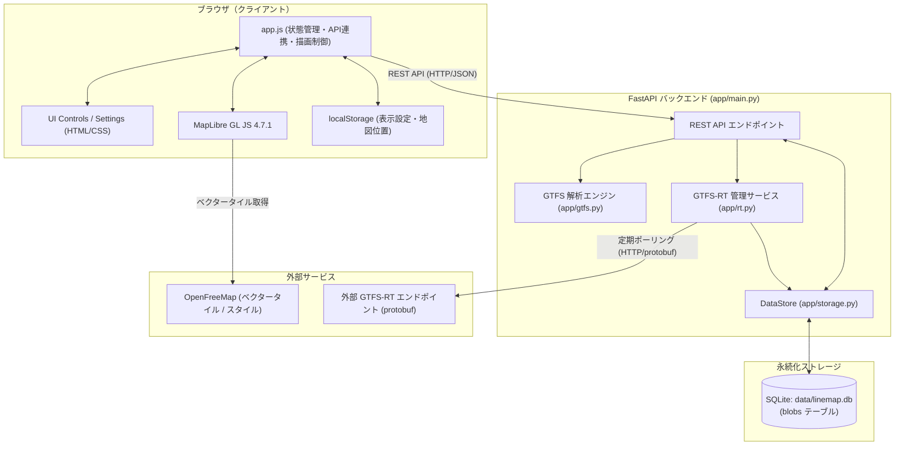
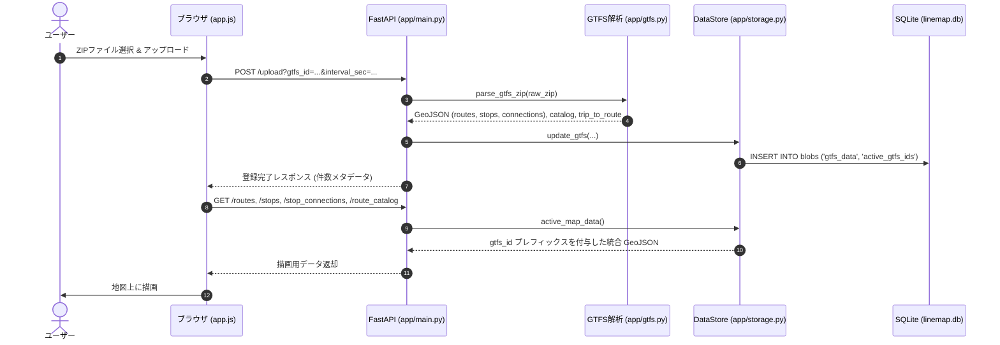

# システム構成・アーキテクチャ

最終更新: 2026-11-01

本書は、LineMap Engine GTFS Visual Platform の全体構成、各モジュール責務、データフロー、およびデータベース仕様を記述したシステム構成書です。

---

## 1. 全体アーキテクチャ概要

本システムは、GTFS（静的データ）と GTFS-RT（リアルタイム車両位置）を統合し、MapLibre GL JS を用いてブラウザ上の地図へ可視化する Web プラットフォームです。
FastAPI バックエンドがデータの取り込み、解析、キャッシュ、GTFS-RT の定期取得を行い、フロントエンドに最適化された GeoJSON を配信します。



---

## 2. ディレクトリ構成

リポジトリ内のコード、テスト、静的ファイル、ドキュメントの配置は以下の通りです。

```text
LineMap_Engine-GTFS_Visual_Platform/
├─ app/                         # バックエンド (FastAPI)
│  ├─ __init__.py
│  ├─ main.py                   # API 定義、ルーティング、ライフサイクル管理
│  ├─ gtfs.py                   # GTFS ZIP 解析、GeoJSON 生成、時刻・路線判定
│  ├─ rt.py                     # GTFS-RT 車両位置取得、protobuf 解析、状態管理
│  └─ storage.py                # DataStore (メモリ上管理 + SQLite blobs 永続化)
├─ static/                      # フロントエンド静的アセット
│  ├─ index.html                # メイン UI 構造、設定モーダル、各種コントロール
│  ├─ app.js                    # MapLibre レイヤー制御、API 通信、表示切替、検索
│  ├─ styles.css                # 画面レイアウト、サイドパネル、モーダルデザイン
│  └─ performance-monitor.js    # 描画負荷・レイヤー切替性能計測スクリプト
├─ data/                        # データベース・データ保管領域
│  └─ linemap.db                # SQLite データベース (実行時自動生成)
├─ docs/                        # プロジェクト詳細ドキュメント
│  ├─ architecture.md           # 本書: システム構成・アーキテクチャ
│  ├─ api.md                    # REST API 仕様書
│  ├─ multi_gtfs_design.md      # 複数 GTFS 管理機能の詳細設計
│  ├─ stop_search_design.md     # 停留所検索機能の詳細設計
│  └─ project_status.md         # 実装状況・既知の課題・ロードマップ
├─ scripts/                     # 開発・検証用スクリプト
│  ├─ gtfs_perf.py              # GTFS 解析パフォーマンス測定
│  └─ rt_validate.py            # GTFS / GTFS-RT 通信検証
├─ tests/                       # テストコード
│  ├─ test_rt.py                # GTFS-RT gzip 展開 / protobuf パースの pytest
│  ├─ test_vehicle_route_ids.py # 車両 route_id 名前空間プレフィックスの pytest
│  ├─ test_route_merge.py       # 往復路線統合判定テスト
│  └─ test_stop_search.html     # 停留所検索のブラウザ検証用 HTML
├─ requirements.txt             # Python 依存ライブラリ一覧
└─ README.md                    # プロジェクトトップ説明書・クイックスタート
```

---

## 3. 主要コンポーネントと役割

### 3.1 バックエンド (`app/`)

| モジュール | 主な役割 |
|---|---|
| `main.py` | FastAPI アプリケーション定義、CORS/キャッシュ無効化ミドルウェア設定、各 REST API エンドポイントの実装、アプリケーション起動・終了時の RT ポーリングタスク（lifespan）管理。 |
| `gtfs.py` | アップロードされた GTFS ZIP の解析。CSV エンコーディング判別（UTF-8, UTF-8 BOM, CP932, Shift_JIS）、サブディレクトリ探索、`shapes.txt` または `stop_times.txt` からの線分生成、停留所連結線の計算、今日の運行便抽出、GeoJSON 出力。 |
| `rt.py` | `RealtimeVehicleService` クラスを提供。GTFS-RT Vehicle Positions（Protocol Buffers）の定期取得、gzip レスポンスの自動展開、緯度経度の妥当性検証、trip_id から route_id の解決、直近エラー履歴の保持。 |
| `storage.py` | `DataStore` クラスを提供。スレッドセーフ（`threading.Lock`）に複数 GTFS データセットをメモリ上に保持し、SQLite (`data/linemap.db`) の `blobs` テーブルへ JSON シリアライズして永続化。アクティブ GTFS の GeoJSON 統合およびプレフィックス付与。 |

### 3.2 フロントエンド (`static/`)

| ファイル | 主な役割 |
|---|---|
| `index.html` | 地図表示領域、左側コントロールパネル（GTFS設定、レイヤー切替、長距離便除外、運行時刻表示切替、路線一覧、停留所検索）、個別 GTFS 設定モーダル、通知トーストなどの HTML 構造。 |
| `app.js` | MapLibre GL JS の初期化、スタイル切替（OpenFreeMap: Liberty/Bright/Positron）、GeoJSON ソース・レイヤーの管理、停留所・路線・車両のインタラクション（ポップアップ、ハイライト、検索ズーム）、往復路線統合アルゴリズム、localStorage への設定保存。 |
| `styles.css` | モダンでレスポンシブな UI スタイル定義。ダークトーンのアクセント、スクロールバー制御、レスポンシブ配置。 |
| `performance-monitor.js` | 開発者コンソールから `PerformanceMonitor.measureStopConnectionToggle()` 等を実行し、レイヤー描画のレンダリング時間をミリ秒単位で計測。 |

---

## 4. データフローと名前空間

### 4.1 GTFS アップロード・永続化フロー



### 4.2 複数 GTFS の名前空間分離 (`gtfs_id:`)

複数の GTFS を同時に表示する際、異なる事業者・データセット間で `route_id` や `stop_id` が衝突することを防ぐため、`DataStore.active_map_data()` で自動的に名前空間プレフィックスが付与されます。

- **路線 ID**: `{gtfs_id}:{route_id}`
- **停留所 ID**: `{gtfs_id}:{stop_id}`
- **所属路線一覧**: 各要素に `{gtfs_id}:` が付与される
- **GTFS-RT 車両**: `properties.route_id` も `{gtfs_id}:{route_id}` に自動正規化され、静的路線データと確実に突合可能

### 4.3 GTFS-RT 車両位置ポーリングフロー

```mermaid
sequenceDiagram
    autonumber
    participant Loop as ポーリングループ (rt.py)
    participant Remote as 外部 GTFS-RT サーバー
    participant Store as DataStore
    participant Client as ブラウザ (app.js)

    Loop->>Remote: GET VehiclePositions.pb (timeout: 8s)
    Remote-->>Loop: HTTP 200 (protobuf / gzip)
    Loop->>Loop: gzip展開 & protobuf解析 & 座標検証
    Loop->>Store: trip_to_route 辞書を参照して route_id 補完
    Loop->>Loop: 成功時刻・エラー履歴を更新

    Client->>FastAPI: GET /vehicles (10秒ごと等)
    FastAPI->>Loop: 各 active GTFS の vehicles() & status() 取得
    FastAPI->>FastAPI: vehicle_id / route_id にプレフィックス付与 & vehicle_color 付加
    FastAPI-->>Client: 統合車両 FeatureCollection & status
    Client->>Client: MapLibre レイヤー更新 / 車両マーカー移動
```

---

## 5. データベース仕様 (`data/linemap.db`)

SQLite データベースは Key-Value 型の JSON Blob 保存方式を採用しています。

### テーブル定義

```sql
CREATE TABLE IF NOT EXISTS blobs (
    key TEXT PRIMARY KEY,
    payload TEXT NOT NULL
);
```

### 格納キーとペイロード構造

1. **`gtfs_data`** (辞書オブジェクト)
   ```json
   {
     "sample_id": {
       "agency_name": "サンプル交通",
       "routes_geojson": { "type": "FeatureCollection", "features": [...] },
       "stops_geojson": { "type": "FeatureCollection", "features": [...] },
       "stop_connections_geojson": { "type": "FeatureCollection", "features": [...] },
       "trip_to_route": { "trip_101": "route_A", ... },
       "route_catalog": [
         { "route_id": "route_A", "route_short_name": "1号線", "route_long_name": "...", "route_color": "#FF0000" }
       ],
       "gtfs_rt_config": {
         "gtfs_rt_url": "https://example.com/vehiclePositions.pb",
         "interval_sec": 10,
         "vehicle_color": "#e4572e"
       }
     }
   }
   ```

2. **`active_gtfs_ids`** (文字列配列)
   ```json
   ["sample_id", "subway_id"]
   ```

---

## 6. フロントエンド MapLibre レイヤー構造

MapLibre GL JS に登録される主なソースとレイヤーは以下の順序で重なり合います。

```text
[最前面]
  │  ▲ 車両シンボル・HTMLマーカー (`vehicles-symbol` / DOM マーカー)
  │  │  - GTFS-RT 車両位置、進行方向 (bearing)、事業者別色分け
  │  │
  │  ● 停留所サークル (`stops-circle`)
  │  │  - 停留所ポイント（半径・白枠）、複数GTFS同一地点統合ポップアップ
  │  │
  │  ─ 停留所連結線 (`stop-connections-line`, `stop-connections-line-hit`)
  │  │  - 停留所間を接続する直線・投影線（全便 / 今日運行便切替対応）
  │  │
  │  ═ 路線本体 (`routes-line`, `routes-line-hit`)
  │  │  - shapes.txt ベースの線分（単一線 または 往復統合中心線）
  │  ▼
[最背面: ベースマップ] OpenFreeMap (Liberty / Bright / Positron)
```

